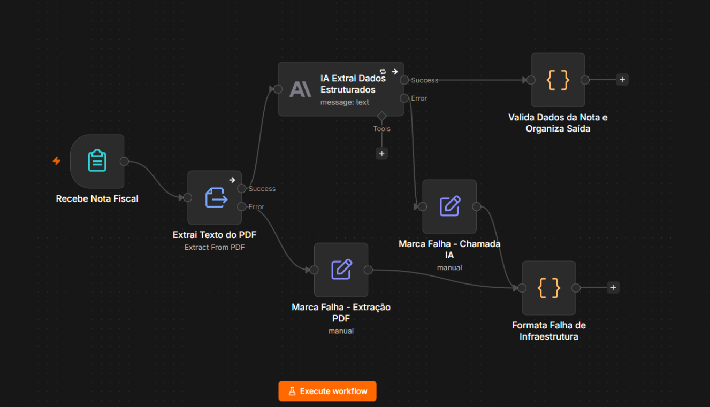

# Extração de dados de notas fiscais com n8n e IA

Automação que recebe o PDF de uma nota fiscal, extrai os dados necessários para o lançamento em contas a pagar e devolve um resultado estruturado — distinguindo o que está pronto para lançar, o que precisa de conferência e o que falhou tecnicamente.



## O problema

Em um grupo com três empresas, as notas fiscais de fornecedores PJ chegam por e-mail em três caixas diferentes, uma por empresa. Alguém baixa o PDF, lança manualmente numa planilha de contas a pagar (número da nota, valor, vencimento, centro de custo) e avisa o gestor da área por WhatsApp para aprovar.

O resultado é previsível: notas se perdem, vencimentos passam e ninguém sabe o status sem perguntar.

Este repositório implementa a primeira fatia do caminho — do recebimento da nota até a extração e estruturação dos dados. O desenho da solução completa, incluindo checagem de duplicidade, registro central, notificação e aprovação, está em [`docs/desenho-da-solucao.pdf`](docs/desenho-da-solucao.pdf).

## Como funciona

O fluxo tem dois caminhos.

**Caminho principal.** Um formulário recebe o PDF e a empresa do grupo. O texto é extraído do arquivo e enviado ao Claude Haiku 4.5, que devolve um JSON com número da nota, valor, vencimento e centro de custo, mais a razão social e o CNPJ do fornecedor e do destinatário. Um nó de validação interpreta a resposta, normaliza nulos e verifica quais campos vieram preenchidos.

**Caminho de falha técnica.** Quando a leitura do PDF ou a chamada à API falham por motivo técnico — independentemente do conteúdo da nota — a execução desvia para um ramo que registra a etapa que quebrou, a mensagem original e a ação recomendada para quem opera.

A saída é sempre no mesmo formato:

```json
{
  "erro": false,
  "revisao_parcial": true,
  "campos_faltando": ["centro_de_custo"],
  "mensagem": "Extração parcial. Campos não identificados: centro_de_custo. Lançar com status \"Conferência pendente\".",
  "empresa": "Empresa A",
  "numero_nota": "009134",
  "valor": "3694.50",
  "vencimento": "2026-10-10",
  "centro_de_custo": null,
  "fornecedor": "PAPELARIA NORTE SUPRIMENTOS EIRELI",
  "cnpj_fornecedor": "08443176000162",
  "empresa_destinataria": "MERIDIANA SERVICOS ADMINISTRATIVOS LTDA",
  "cnpj_destinatario": "31702664000108"
}
```

## Decisões de projeto

**Extração parcial não descarta a nota.** Se o número, o valor e o vencimento vierem corretos mas o centro de custo não existir no documento, a nota é lançada com `revisao_parcial: true` e a lista de campos faltantes. O financeiro completa um campo em vez de refazer o lançamento inteiro. Rejeitar a nota por um campo ausente devolveria todo o trabalho manual que a automação deveria eliminar.

**Erro e conferência pendente são estados diferentes.** `erro: true` significa que não dá para seguir. `revisao_parcial: true` significa que dá para lançar, com ressalva. Misturar os dois faria o financeiro tratar como exceção algo que é rotina — DANFE de mercadoria quase nunca traz centro de custo.

**O centro de custo nunca é inferido.** O prompt proíbe explicitamente usar pedido de compra, contrato, projeto ou descrição de produto como substituto. Um campo em branco sinalizado custa menos ao financeiro do que um campo preenchido errado, que passa despercebido até o pagamento sair na conta errada.

**IA em vez de expressões regulares.** O layout varia a cada fornecedor. Uma regex quebraria a cada fornecedor novo e a manutenção recairia sempre sobre a mesma pessoa. O modelo também distingue emitente de destinatário, que é onde regras posicionais costumam errar.

**O prompt trata as iscas do documento.** Uma DANFE traz transportadora, banco e escritório de contabilidade além das duas empresas da operação. O prompt instrui explicitamente a não confundi-los com o fornecedor, e usa sufixos empresariais e proximidade de CNPJ como pistas de razão social.

**Normalização na origem.** Valor com ponto decimal, data em `AAAA-MM-DD`. O destino recebe dados prontos para ordenar e somar. O número da nota, ao contrário, é preservado exatamente como impresso, incluindo zeros à esquerda, para não gerar colisão na checagem de duplicidade.

**Retry só onde faz sentido.** A chamada à IA repete até três vezes com intervalo de cinco segundos, porque indisponibilidade de API é transitória. A leitura do PDF não tem retry: arquivo corrompido falha igual nas três tentativas e só atrasaria a mensagem de erro.

**Mensagens escritas para quem opera, não para quem programou.** Cada saída de erro traz o que aconteceu e o que fazer, em português. A tabela completa está na documentação.

## Como rodar

**Pré-requisitos:** uma instância do n8n (a versão gratuita serve) e uma credencial da API da Anthropic.

1. Importe `workflow/extracao-notas-fiscais.json` no n8n.
2. Abra o nó `IA Extrai Dados Estruturados` e selecione sua credencial da Anthropic — o arquivo é publicado sem credenciais.
3. Execute o workflow e abra o link do formulário.
4. Anexe uma das notas de `exemplos/` e escolha qualquer empresa do grupo.

As notas de exemplo cobrem três cenários:

| Arquivo | O que demonstra |
|---|---|
| `nota-fiscal-servico.pdf` | Extração completa — os quatro campos preenchidos |
| `nota-fiscal-mercadoria.pdf` | Extração parcial — sem centro de custo, com doze valores concorrentes, duas parcelas, transportadora e banco como iscas |
| `nota-fiscal-corrompida.pdf` | Falha técnica na leitura do PDF |

Todos os documentos são fictícios: empresas, CNPJs, endereços e o município são inventados e não correspondem a nenhuma entidade real.

## Estrutura

```
.
├── workflow/
│   └── extracao-notas-fiscais.json   # fluxo do n8n, sem credenciais
├── exemplos/                          # notas fiscais fictícias para teste
├── docs/
│   ├── desenho-da-solucao.pdf         # solução de ponta a ponta
│   ├── documentacao-do-fluxo.pdf      # o trecho implementado
│   └── fluxo.png
└── README.md
```

## Premissas

Três empresas no grupo, cada uma com caixa de e-mail própria, e volume estimado de 20 a 30 notas por semana somando as três. Um gestor por centro de custo responsável pela aprovação, com SLA proposto de 2 dias úteis.

A entrada é por formulário em vez de e-mail real. Na solução desenhada o gatilho é IMAP, e a caixa de destino já identifica a empresa sem intervenção de ninguém; da extração de texto em diante a lógica é idêntica.

Assume-se PDF com camada de texto. Nota digitalizada como imagem exigiria uma etapa de OCR, fora do escopo desta fatia — nesse caso o fluxo trata como falha de leitura, não como nota inválida.

## Fora do escopo

Checagem de duplicidade, lançamento em registro central, notificação ao gestor e aprovação. Todos descritos no desenho da solução, nenhum implementado aqui.

Vale registrar um ponto que o desenho trata e a implementação não resolve sozinha: o texto da nota vai integralmente para o modelo, então um documento preparado pode conter instruções tentando alterar a extração. A validação de formato da saída e a aprovação humana antes do pagamento são as barreiras previstas.

## Sobre dados pessoais

A nota pode conter razão social, CNPJ e, quando o prestador é pessoa física, nome civil — dado pessoal sujeito à LGPD. O PDF e o texto extraído passam pelo log de execução do n8n e ficam retidos nele; nas saídas de erro de conteúdo, o campo `texto_bruto` carrega o texto integral da nota.

Em produção, isso pede acesso restrito aos logs e retenção definida em vez de indefinida. O envio do texto à API também configura transferência internacional de dados pessoais, que precisaria ser validada com a encarregada de dados antes de entrar em operação.

## Stack

n8n · Claude Haiku 4.5 (API Anthropic) · JavaScript

---

Projeto desenvolvido para um desafio técnico. O cenário e os dados são fictícios.
